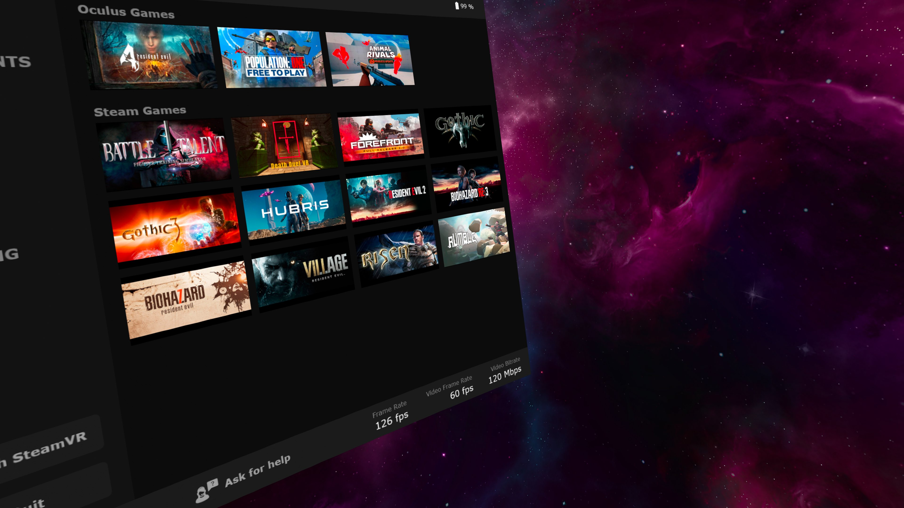

<p align="center"></p>

# Virtual Desktop Unlock

**v0.2.5** · Windows x64 · Unofficial · MIT

An unofficial program for extending Virtual Desktop Streaming. Modifications are applied only to the back-end server component installed on Windows; the client requires no modification. Add custom Steam games, including games that use third-party VR mods, to Virtual Desktop's actual headset Games tab using the optional runtime helper. The desktop companion app organizes your installed Steam games, saves selections for the helper, and provides optional headset-specific bitrate ceilings. There is also an option to set application launch presets, such as for FPS, quality, and FOV tangent.

> The application has only been tested on the Quest 3. The Quest client may differ from the versions for Pico 4, Galaxy XR (Android XR), HTC Vive Focus 3, etc., so this mod might not function correctly on those devices. Additionally, the mod is still under development and may contain bugs.



## Unlock features

| Feature | Description |
|---|---|
| Third-party games | Adds custom Steam IDs to Streamer's game discovery. There is also an option to add games from [Venture](https://github.com/Villagers654/Venture) to the Oculus Games category (this feature has not yet been tested on the Pico 4). |
| Game launch presets | Allows you to set custom launch parameters, such as FPS, quality, FOV tangent, VDXR render resolution, and sharpening. These settings are applied before the game launches. Once the game is closed, the settings revert to their original values ​​as configured in VD. |
| Unlimited bitrate | Allows you to set your own bitrate limit for Wi-Fi or USB connections, though there is no guarantee that the stream will work correctly. This is an experimental feature. |
| Remap Buttons | Key binding modifications for SteamVR and OpenXR games at the streamer level. |

## Download and run

Download the archive from [Release](https://github.com/ShadowManXR/VirtualDesktop-Unlock/releases)

Launch the Virtual Desktop Unlock program; you can then close the window, as the application will remain in the system tray. For its features to be available, the program must be running in the background; to ensure this, select the option in the application settings to have it launch automatically when Windows starts.

## Troubleshooting

The desktop app writes startup events, library scan warnings, and exception details to `%LOCALAPPDATA%\Virtual Desktop Unlock\Logs\app.log`. It keeps the previous log as `app.log.1`. Streamer helper and installer errors are recorded in `%ProgramData%\Virtual Desktop\LibraryOverrides.log` and `%ProgramData%\Virtual Desktop Unlock\installer.log`.

## Future plans

| Feature | Description |
|---|---|
| FOV Tangent Fill-Reconstruct | The FOV tangent sets reduced rendering dimensions, which results in the appearance of black areas; these can be filled using various methods, such as gradients, blurring, or mirroring. |
| Anti-drift stick | Handle stick presses when a finger is resting on the stick, by leveraging the ability to detect finger contact with the stick. A partial solution. |
| Third-party games not on Steam | Add any VR .exe application, complete with an image, so that it appears in the VD game panel. |

## Build

Install the .NET 10 SDK on Windows x64. The build also uses the .NET Framework C# compiler and WPF reference assemblies supplied with Windows. The app has no third-party NuGet dependencies.

```powershell
powershell -NoProfile -ExecutionPolicy Bypass -File .\build.ps1
```

The build runs the companion UI/storage tests and an AppDomain-manager loading test, then creates the release ZIP and SHA-256 checksum in `artifacts/dist/`. For the additional delayed-initialization test against your own supported Streamer installation:

```powershell
.\build.ps1 -StreamerPath 'C:\Program Files\Virtual Desktop Streamer\VirtualDesktop.Streamer.exe'
```

That test uses an isolated configuration directory and does not launch a VR game or install the integration. A build never changes your current Streamer installation.

The MIT license applies to this project's original code. The icon incorporates Virtual Desktop branding; see [artwork attribution](assets/README.md). Install Virtual Desktop and Steam separately from their official sources.

## Disclaimer

All rights in Virtual Desktop belong to its creators and respective rights holders.

We respectfully ask the creators of Virtual Desktop to allow this unofficial add-on to remain available. Its sole purpose is to improve the Virtual Desktop experience by adding optional features. We would welcome seeing these features implemented officially in Virtual Desktop.

If the rights holders ask, we will stop development and remove this repository.
